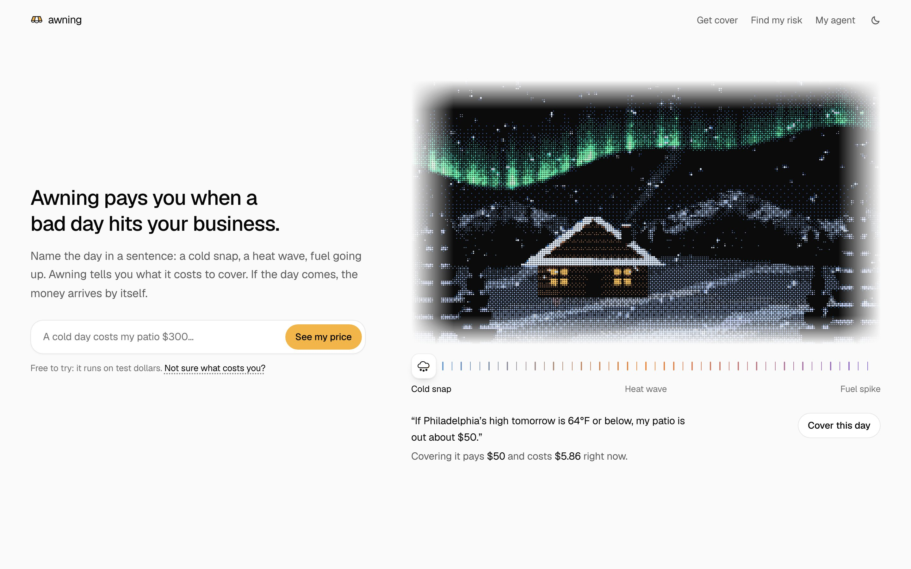
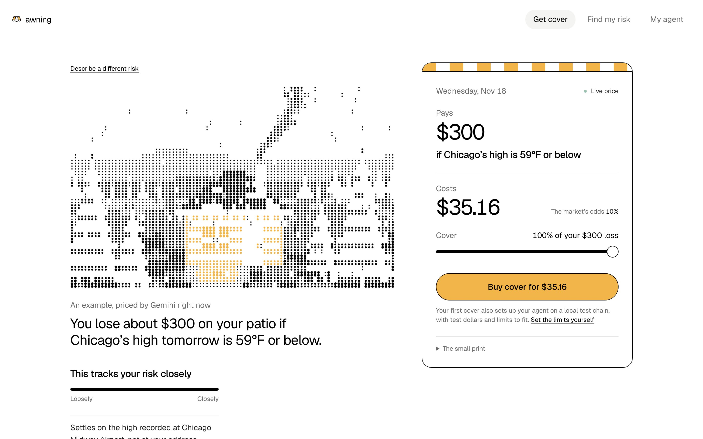
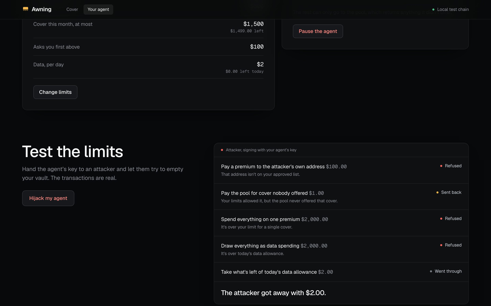

# Awning

**Say what could go wrong. Get paid when it does.**

Awning turns a sentence about a business risk into cover priced by Gemini prediction markets. An AI
agent buys it for you, or keeps buying it every day on its own judgement. Two contracts on Arc hold
the money: a mandate that limits what the agent can spend, and a pool that locks your whole payout
before you pay a cent.



> "If Chicago's high stays under 46 tomorrow, my coffee cart is out about $300."
>
> **Pays $300 if Chicago's high is 45°F or below. Costs $25.60.**
>
> A real quote on Arc testnet, 13 November 2026.

Built for the University Blockchain Conference 2026 hackathon.

| | |
| --- | --- |
| Agent's limits | [`AwningMandate`](https://testnet.arcscan.app/address/0x708ae0910eFAf32B97D0bA9429C4F2BD44988413) on Arc testnet |
| Cover pool | [`AwningPool`](https://testnet.arcscan.app/address/0x0dE9149998eE6CAA3577007f31A1803Bc49C3F6F) on Arc testnet |
| Tests | 126 contract tests with fuzzing and invariants, 35 engine tests |
| Stack | Next.js 16, React 19, Solidity 0.8.28 (Foundry), viem, Postgres, Claude |

## Contents

- [Quick start](#quick-start)
- [What it looks like](#what-it-looks-like)
- [The problem](#the-problem)
- [What Awning does](#what-awning-does)
- [The mandate](#the-mandate)
- [The pool](#the-pool)
- [Architecture](#architecture)
- [The agent's decision loop](#the-agents-decision-loop)
- [Economic design and risk assumptions](#economic-design-and-risk-assumptions)
- [Sponsor technology](#sponsor-technology)
- [Running on Arc testnet](#running-on-arc-testnet)
- [Tests](#tests)
- [What is real and what is not](#what-is-real-and-what-is-not)
- [Repository layout](#repository-layout)
- [License](#license)
- [What comes next](#what-comes-next)

## Quick start

Requires Node 22 or newer and [Foundry](https://getfoundry.sh).

```bash
npm install
cp .env.example .env.local     # then set ANTHROPIC_API_KEY
npm run chain                  # local chain with both contracts and a funded pool
npm run dev                    # in a second terminal
```

Open http://localhost:3000 and type a risk into the box, or press **Open the app**. To buy cover,
go to **Your agent**, press **Get test dollars**, then **Set allowance**.

`ANTHROPIC_API_KEY` is the only key you need. Everything else in `.env.example` is optional: with no
Gemini trading keys the pool's own hedge fills on paper against Gemini's live prices. The cover
itself is real either way, locked onchain and paid on Gemini's resolution.

## What it looks like

**A quote.** What the cover pays, the market's odds, what it costs, and where a payout could differ
from your actual loss.



**The hijack test.** One button hands the agent's real key to an attacker and sends real
transactions. The contracts refuse everything except the day's data budget.



## The problem

Small businesses carry risks nobody will insure: a cold day, a spike in fuel, the home team losing.
Prediction markets price exactly these events, and owners have started using them by hand (Fortune
reported a restaurant group putting $60,000 on a baseball outcome in October 2026). Doing it by hand
means finding the right contract among a thousand, working out how many to buy, and understanding
where the market's settlement differs from your actual loss. Almost nobody will.

Handing the job to an AI agent creates the second problem. An agent that can spend money and reads
text written by strangers will eventually be talked into something. A spending limit written in a
prompt is a suggestion.

## What Awning does

1. **You describe a risk in a sentence**, typed or spoken.
2. **Claude turns it into a structured exposure**: what has to happen, where, when, and what it costs you.
   If something essential is missing it asks one question. If Gemini lists nothing that tracks the
   risk, it says so and records the gap.
3. **The engine matches it to live Gemini contracts** and builds the position that pays when your
   trigger happens: a basket of temperature buckets, a Yes or No on a price strike, or a No on a team.
4. **You get a receipt, not a trading screen**: what it pays, the market's odds, what it costs, and
   a plain account of where a payout could differ from your loss (the settlement station, a snapped
   threshold, a proxy asset, a thin book).
5. **For temperature markets the agent buys a second opinion.** It pays two cents over x402 for an
   ensemble weather forecast and checks the market's price against it.
6. **The pool offers the cover and locks the payout.** Asking to buy has the pool post an offer
   onchain, which sets the whole payout aside in the pool contract before any premium moves.
7. **The agent asks the mandate for the premium.** Inside your limits it just acts. Above your
   approval line it has to come back for a signature from your device. Outside your limits the
   contract refuses and records the refusal.
8. **The pool covers itself on Gemini** by buying the same position there. That is the pool's
   business: your cover is in force whether or not its order fills.
9. **When Gemini resolves the market**, the pool pays your vault in USDC, or keeps the premium.

You can also leave a daily risk with the agent. Each day it looks at that day's price and forecast
and decides for itself whether the cover is worth buying, inside a cap you set, and writes down why.

## The mandate

`contracts/src/AwningMandate.sol` holds each owner's USDC and enforces what their agent may do:

| Limit | Enforced as |
| --- | --- |
| Daily allowance for buying data | `drawFloat` moves at most this much per UTC day to the agent's own address |
| Most for one cover | `openHedge` refuses a larger premium |
| Most for cover per 30-day period | `openHedge` refuses once the period total is reached. Periods are fixed windows, so spending can bunch on either side of a boundary |
| Where premiums may go | `openHedge` only pays venues the owner has allowlisted |
| Ask me first above | Larger premiums need the owner's EIP-712 signature over the exact terms |
| Pause | `setPaused` stops everything the agent can do |
| Expiry | The policy lapses on a date the owner sets |

A refusal is not a revert. The transaction succeeds, moves nothing, and emits
`Blocked(owner, agent, action, reason, amount, counterparty, ref)`, so every attempt the agent was
denied is part of the permanent record and shows up in the owner's activity feed.

**What a hijacked agent can take.** The app has a "Hijack my agent" button that hands the agent's
real key to an attacker script and sends real transactions:

1. Pay a premium to the attacker's address. Refused: not an approved payee.
2. Pay the pool a dollar for cover it never offered. The mandate allows it, since the pool is
   approved and a dollar is inside every limit. The pool sends it straight back.
3. Spend the whole balance on one premium. Refused: over the per-cover limit.
4. Draw the whole balance as data spending. Refused: over the daily allowance.
5. Take whatever is left of today's data allowance. This one succeeds.

With the default limits the attacker gets $2.00 out of a $2,000 vault. The contract exposes that
number as `limits(owner).floatRemainingToday`, and the app shows it before the button is pressed.

This test assumes the worst about the agent: that its key is fully in someone else's hands. It
does not test whether the model can be talked into something, because the limits hold either way.
It does not cover a break-in to the server, which also holds the pool's underwriter key; see the
trust notes under "Economic design".

The owner's key never reaches the server. In this build it is generated in the browser and kept in
local storage; the contract verifies owners through `SignatureChecker`, so a passkey smart account
(ERC-1271) works without changing it.

## The pool

`contracts/src/AwningPool.sol` is the other side of every cover. It is a USDC vault (ERC-4626) whose
depositors earn premiums and bear payouts.

| Step | What happens onchain |
| --- | --- |
| Offer | The underwriter posts `offer(hedgeId, owner, premium, payout, marketRef, takeBy, resolveBy)`. The pool must hold `payout` free, and locks it. No more than half the pool may ride on one market |
| Take | The owner's agent pays the premium through the mandate with the pool as venue. The pool never hears about it; `taken(hedgeId)` reads the mandate and checks that the same owner paid exactly the offered terms before `takeBy` |
| Settle | The resolver reports whether the event happened. The pool pays the owner's vault the full payout, or keeps the premium |
| Lapse | An offer nobody took by `takeBy` can be unlocked by anyone |
| Reject | A premium that reached the pool without taking a live offer (none, other terms, or too late) can be sent back by anyone |
| Claim | If no result is reported by `resolveBy` (three days after the market closes), anyone can trigger the payout to the owner |

Depositors can withdraw only what isn't locked. The pool keeps its own books: a premium counts as
the pool's only once its cover has settled, so money that merely landed there can't be withdrawn or
promised to someone else. Hedge ids belong to their owner in the mandate, so nobody can use up an
id the pool has offered to someone else. The invariant suite checks, over random sequences of every
action including late and mismatched payments, that the pool holds everything on its books, that
its books cover everything locked, and that `locked` equals the sum of live offers.

An independent review of the first version of the pool found that an offer could be taken after its
deadline, that another account could spend an offered id, and that stray premiums were counted as
free assets. All three are fixed and have tests.

## Architecture

```
 browser                         server (Next.js)                         outside
 ───────                         ────────────────                         ───────
 device key (owner) ──signs──▶   /api/interpret ─────────────────────▶   Claude
   allowance, approvals          /api/plan ──▶ hedge engine ─────────▶   Gemini public market data
                                     │            └─▶ second opinion
                                     │                  │ x402: 402 → sign → settle
                                     │                  ▼
                                     │            /api/desk/forecast ───▶ Open-Meteo ensemble
                                 /api/covers ─┬▶ underwriter key ──▶ AwningPool.offer   (locks the payout)
                                              ├▶ agent key ────────▶ AwningMandate.openHedge ──▶ premium to the pool
                                              └▶ Gemini trading API  (the pool's own hedge; paper without keys)
                                 /api/standing ▶ agent: forecast → Claude decides buy or skip → same path as above
                                 background ───▶ resolver key ─────▶ AwningPool.settle ──▶ payout to the owner's vault
                                 /api/streams ◀── QuickNode Stream ◀── logs of both contracts
                                     │
                                 Postgres: covers, standing orders, decisions, ledger, odds history, gaps
```

- `src/lib/gemini` reads Gemini's prediction market API and normalises three market shapes:
  partitions (temperature buckets), ladders (nested price strikes) and moneylines.
- `src/lib/hedge` is the engine: exposure schema, market matching, leg construction, pricing with
  Gemini's fee formula, and the basis assessment. It is pure and unit-tested against recorded Gemini data.
- `src/lib/covers` has the pool offer, opens through the mandate, and settles on Gemini's resolution.
- `src/lib/agent` runs standing orders: the daily decision and the record of why.
- `src/lib/desk` is the forecast desk (seller) and the agent's x402 buyer.
- `src/lib/ledger` stores contract events, delivered by a QuickNode Stream when one is registered and
  read from the chain's logs otherwise.
- `src/lib/chain/cctp.ts` and `/api/cashout` send vault money to other chains through Circle's CCTP.
- `src/components/Ascii.tsx` plays the animated scenes on the landing page and inside the app. They
  come from [ascii-magic-art](https://www.ascii-magic.com/ascii) (MIT), bundled from the npm package
  so nothing is loaded from a third party at run time.
- `src/lib/venue` places the pool's hedge: through Gemini's trading API when keys are set, on paper otherwise.

## The agent's decision loop

**When you ask for cover**, the agent runs a fixed sequence. The model is used for one step and
never chooses which transaction to send.

1. **Interpret** (Claude, structured output): sentence → `Exposure`, or one clarifying question, or "unlisted".
2. **Match** (code): find the market that settles on the exposure's subject and date.
3. **Construct** (code): choose legs, snapping the user's threshold to the market's steps and reporting the snap.
4. **Check** (code + paid data): for temperature markets, buy an ensemble forecast over x402 from the
   owner's data allowance and compute a fair price per leg.
5. **Price** (code): what Gemini is asking plus its fee, so the pool can lay the risk off at once.
   With nobody asking, the middle of the book, anchored on `min(mid, fair)`.
6. **Explain** (code): basis notes and a fit score.
7. **Offer** (underwriter key): `AwningPool.offer` locks the payout.
8. **Ask the mandate** (agent key): `openHedge`. The outcome is one of opened, opened with the owner's
   signature, or `Blocked` with a reason.
9. **Lay off** (Gemini): the pool buys the position it has just sold. A failure leaves the pool
   unhedged and the owner's cover untouched.
10. **Settle** (resolver key): when Gemini resolves, `AwningPool.settle` pays the vault or keeps the premium.

**When you leave a risk with it**, the agent acts with nobody watching. Once a minute, for each
standing order and for today's and tomorrow's market:

1. **Look** (code + paid data): price the day's cover, and buy that day's forecast.
2. **Rule out** (code): skip without asking the model if cover costs what it pays, costs more than
   the owner's cap for one day, or is above the owner's ask-first line.
3. **Decide** (Claude, structured output): buy or skip, given the price, the market's odds, the
   forecast's odds, the cap and the owner's own instruction. It must give its reason in plain words.
4. **Act** (code): on "buy", steps 7 to 9 above. The mandate can still refuse, and that is recorded too.
5. **Record**: the decision, the reason, and the numbers the agent saw, shown on the agent page.

One decision is kept per order per market day, so a day is never bought twice.

**Safety limits in force**

- Onchain, outside the model: every limit in the mandate table above.
- In the x402 client: a per-request ceiling of $0.05 and an allowlist of sellers, applied before anything is signed.
- In the server: quotes are re-priced server-side from live data; the browser's numbers are never trusted.
  A cover's onchain `marketRef` commits to the exact contracts and sides it was priced on.
- At the API: every request that reads or spends an owner's account carries a session signed by
  that owner's key and verified against the chain, so nobody can ask the agent to act for someone else.
- In the design: the model makes exactly two kinds of call. It turns a sentence into an `Exposure`,
  which the owner sees restated before buying. And for a standing order it answers buy or skip for
  one day. It never chooses an amount, a payee or a market: those come from code, and the mandate
  bounds them whatever the model says.
- In the pool: cover exists only on terms the underwriter offered. Anything else paid to the pool is returned.

## Economic design and risk assumptions

- **Cover is a position, not a policy.** Awning buys binary contracts that pay $1 each. The cost of
  cover is the market's probability plus fees. Likely events are expensive to cover and the receipt says so.
- **Basis risk is the main risk and is stated, not hidden.** Temperature settles on one airport
  station per the NWS daily climate report. Price markets settle on a reference index at one moment.
  A proxy (diesel hedged with crude) is flagged and scored down. The fit score is a heuristic.
- **The pool is the counterparty.** Owners buy from the pool at Gemini's asking price plus Gemini's
  fee, so the pool can hedge at once and its margin today is zero. When nobody is asking, the pool
  prices off the middle of the book and carries the risk itself until its resting order fills.
  A spread for depositors is one parameter away and deliberately not set.
- **Liquidity is thin, on Gemini and in the pool.** Many Gemini contracts have no offer. The pool
  refuses cover it can't fully lock, and caps any one market at half its assets.
- **Depositors' shares are priced on the pool's books,** not marked to its open cover. Someone
  depositing while the pool has cover outstanding buys into that risk at face value, and a depositor
  who learns a result before it is reported can leave ahead of the loss. A withdrawal delay would
  close that; it isn't built.
- **A quote lasts five minutes.** After that the offer lapses and the payout is unlocked, so a price
  can't be held as a free option on where the market goes. Cover that would cost as much as it pays
  is not offered.
- **The forecast is a second opinion, not truth.** It is a raw 31-member GFS ensemble with half a
  member of smoothing per bucket and no bias correction. It can lower a bid and cannot raise one.
- **Who is trusted, and for what.** Gemini is a centrally cleared, dollar-funded exchange with
  nothing onchain, so no contract can see its results.
  - The *resolver* key reports whether the event happened. An owner trusts it to report Gemini's
    public resolution honestly. `evidence` is a hash of the resolution it saw, the hedge's
    `marketRef` commits to the exact Gemini contracts, and a resolver that goes silent loses: after
    `resolveBy` the owner is paid in full.
  - The *underwriter* key decides what the pool offers. Depositors trust it not to offer cover
    cheaply on something that has already happened.
  - In this build one server holds the agent, underwriter and resolver keys. An attacker with only
    the agent's key gets the day's data allowance. An attacker who takes the server could also
    misprice or misreport, which costs the pool's depositors or cover holders, bounded by the pool
    and by each owner's limits. Separating those keys, and a challenge window on results, come next.
- **Fees** use `rate × price × (1 − price)` per contract with taker 7% and maker 1.75%. These rates
  come from a third-party summary of Gemini's schedule and are labelled as estimates.

## Sponsor technology

**Arc.** The mandate and the pool are deployed on Arc; USDC is the asset in the vault, the asset in
the pool and the gas, so an owner needs one token and sees one balance. The x402 payments settle as EIP-3009
`transferWithAuthorization` on Arc's native USDC (`0x3600…0000`, EIP-712 domain `USDC`/`2`).

| Contract | Arc testnet (5042002) |
| --- | --- |
| AwningMandate | [`0x708ae0910eFAf32B97D0bA9429C4F2BD44988413`](https://testnet.arcscan.app/address/0x708ae0910eFAf32B97D0bA9429C4F2BD44988413) |
| AwningPool | [`0x0dE9149998eE6CAA3577007f31A1803Bc49C3F6F`](https://testnet.arcscan.app/address/0x0dE9149998eE6CAA3577007f31A1803Bc49C3F6F) |
| USDC | `0x3600000000000000000000000000000000000000` |

**Circle CCTP.** A payout shouldn't be stuck on the chain it was paid on. "Send money out" on the
agent page withdraws from the vault and burns the USDC through CCTP V2's `TokenMessengerV2` on Arc
(domain 26) with the Forwarding Service hook, so Circle mints it natively on Base, Ethereum or
Avalanche and the receiver needs no gas there. The fee comes from Circle's `/v2/burn/USDC/fees`
and delivery is tracked through `/v2/messages`. Verified on testnet: $1 out of a vault on Arc,
$0.95 at the same address on Base Sepolia a few seconds later.

**Gemini Prediction Markets.** Market data: `GET /v1/prediction-markets/events` filtered by
`category`, `search` and `status`, and `GET /v1/prediction-markets/events/{ticker}` for prices and
resolution. Trading: `POST /v1/prediction-markets/order`, `/orders/active`, `/orders/history` and
`/terms/status`, signed with HMAC-SHA384. The trading calls have not been run against Gemini's
sandbox yet; without keys the pool's hedge fills on paper. Gemini's API has no price history, so Awning records its
own and charts what a dollar of each cover has cost over time. Risks people ask about that no market
tracks are stored as gaps.

**QuickNode Streams.** The activity ledger is built to be fed by one Stream. The filter, the
webhook handler and a replay test are in this repository. The Stream itself is not registered yet,
because it needs a public URL to deliver to, so today's deployment reads the contracts' logs directly.

- Network: Arc testnet.
- Dataset: `block_with_receipts`, chosen over `logs` because each block carries its timestamp, so
  the app never calls back to the chain to date an event.
- Filter: `quicknode/filter.js`. It keeps logs whose `address` is the mandate or the pool, attaches the block
  timestamp, and returns `null` for blocks with none, so empty blocks are not delivered.
- Destination: webhook, `POST /api/streams`. The handler verifies QuickNode's
  `X-QN-Signature` (HMAC-SHA256 over nonce + timestamp + body, keyed with the Stream's security
  token), inflates gzip, and stores events idempotently by `txHash:logIndex`, which makes
  redelivery and backfill safe.
- `scripts/replay-streams.mjs` runs the same filter file over a local chain's blocks and posts the
  result, signed the same way, to test the path end to end.

**ElevenLabs.** Scribe (`scribe_v2`) transcribes push-to-talk recordings; Flash (`eleven_flash_v2_5`)
streams spoken replies: the clarifying question, the quote, and refusals. Replies are only spoken
after the person has used the microphone. This path has not been exercised with a live key yet.

**x402.** The forecast desk and the agent's buyer use the official `@x402/core` and `@x402/evm`
packages (v2 protocol, `exact` scheme). The desk settles its own sales.

## Running on Arc testnet

Put three fresh keys in `.env.arc` (the chain block of `.env.example`, with
`AWNING_DATA_DIR=.data/pg-arc` so Arc covers stay apart from local ones), send the venue's address
testnet USDC from https://faucet.circle.com, then:

```bash
scripts/deploy-arc.sh   # deploys both contracts with the venue key, seeds the pool, funds gas, fills in .env.arc
npm run start:arc       # production build against Arc, http://localhost:3001
```

Arc enforces a 20 gwei minimum base fee; the script sets the gas price because Foundry's defaults
can leave a transaction pending.

### Hosting

The app runs on any Node host. On a long-running server it does its background work (settling
covers, the agent's daily decisions) on a one-minute timer. On a serverless host such as Vercel
there is no timer, so the same pass runs after a page is served, at most once a minute, and
`vercel.json` adds a daily cron as a floor. A hosted deployment needs `DATABASE_URL` (Postgres),
the chain block of `.env.example`, `ANTHROPIC_API_KEY`, and a `CRON_SECRET`.

## Tests

```bash
npm test                       # engine, settlement and forecast logic
npm run typecheck && npm run lint
cd contracts && forge test     # 126 tests including fuzz and invariants on both contracts
FOUNDRY_PROFILE=ci forge test  # the same tests at four times the fuzz depth; takes several minutes
LIVE=1 npx vitest run src/lib/hedge/live.test.ts   # sentence → priced cover against live Gemini and Claude
```

## What is real and what is not

| Real | Stand-in |
| --- | --- |
| Gemini markets, prices, and resolution | The pool's hedge on Gemini fills on paper unless trading keys are set |
| Every cover: the payout locked in the pool, and paid from it | The resolver that reports Gemini's result is one trusted key |
| Every mandate transaction, including refusals and the hijack test | The owner's key is browser storage rather than a passkey |
| The agent's daily decisions on standing orders, made by the model | The agent, underwriter and resolver keys sit on one server |
| x402 payments, settled onchain per request | The forecast desk is run by the same operator as the agent |
| The forecast data and the odds history | The pool on testnet is seeded by its operator |
| Circle CCTP cash-out, verified on testnet | The QuickNode Stream is not registered yet; the app reads logs itself |
| | Voice has not been tested with a live ElevenLabs key |

## Repository layout

```
contracts/        AwningMandate and AwningPool, their tests, and the deploy script (Foundry)
src/app/          pages and API routes (Next.js App Router)
src/components/   the interface
src/lib/hedge/    the engine: exposure schema, market matching, pricing, basis notes
src/lib/covers/   quoting, buying, settling, and the hijack test
src/lib/agent/    standing orders and the daily buy-or-skip decision
src/lib/chain/    contract calls, the device wallet, CCTP
src/lib/gemini/   prediction market data and trading
src/lib/desk/     the x402 forecast seller and the agent's buyer
src/lib/ledger/   contract events, from QuickNode Streams or from logs
quicknode/        the Stream filter
scripts/          local chain, Arc deploy, Stream replay
drizzle/          database migrations
```

The interface is set in the [Geist](https://vercel.com/font) family: Sans for the interface, Serif
for the two display lines, Mono for values, and Pixel for figures read live from the chain. The
animated scenes come from [ascii-magic-art](https://www.ascii-magic.com/ascii), drawn in one ink.

## License

MIT. See [LICENSE](LICENSE).

## What comes next

- A challenge window on results, so a wrong report can be disputed before the pool pays or keeps.
- The underwriter and resolver keys on separate machines from the agent.
- Open deposits into the pool from the app, and a spread that pays depositors for the risk.
- Passkey smart accounts for owners, and gas paid for them.
- Funding the pool's Gemini account from its USDC, so its hedge and its collateral are one balance sheet.
- Bias-corrected forecasts, and fair values for price markets from options-implied volatility.
- Publishing the gaps list to Gemini as demand for new markets.
