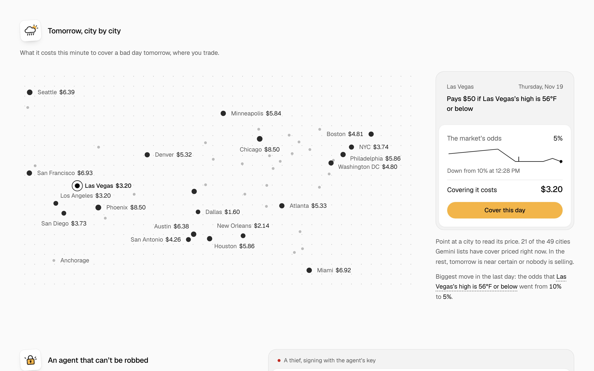
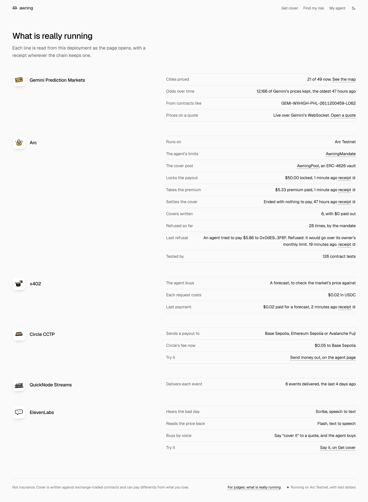
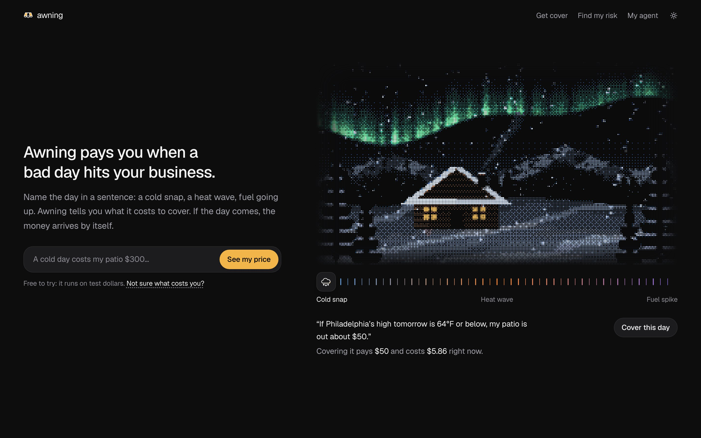
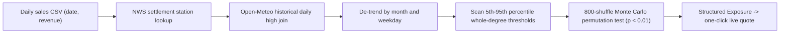
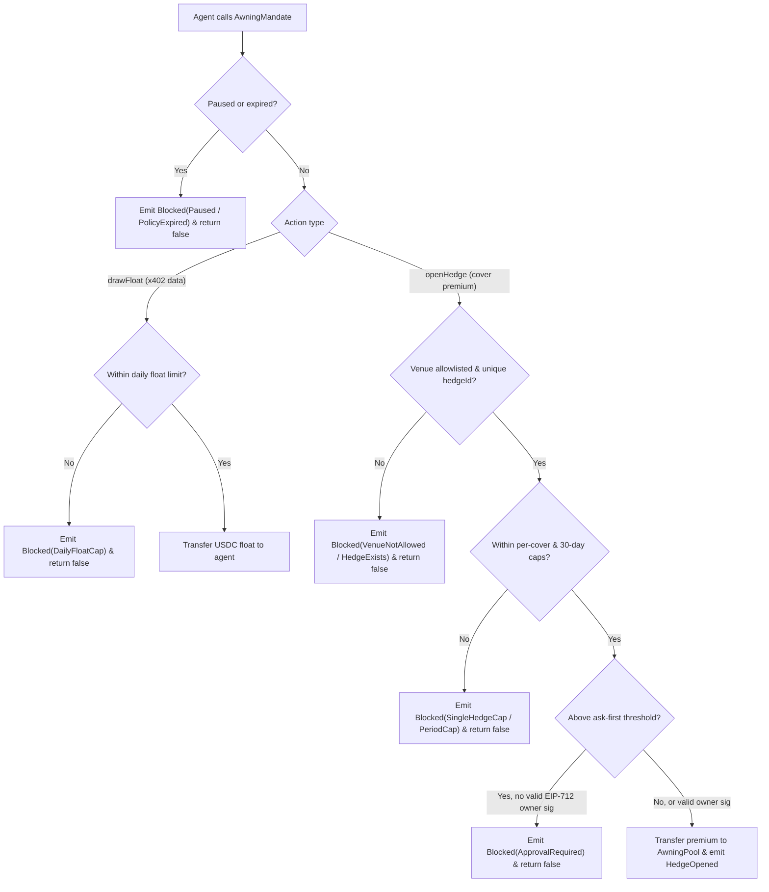
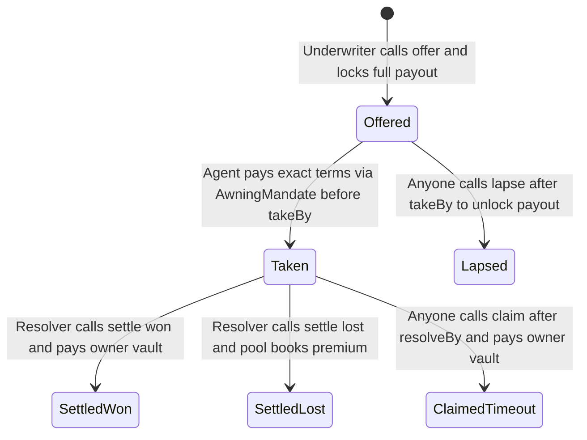
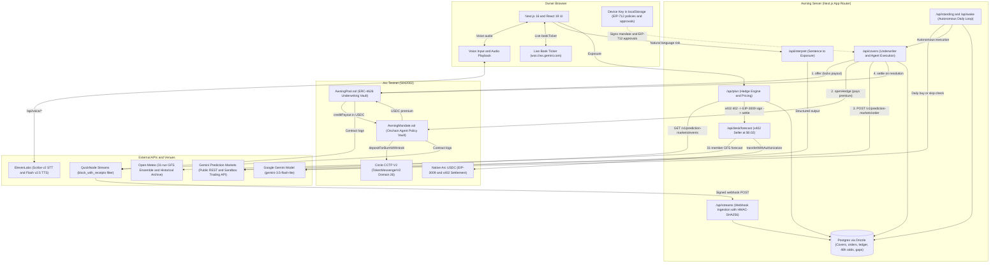
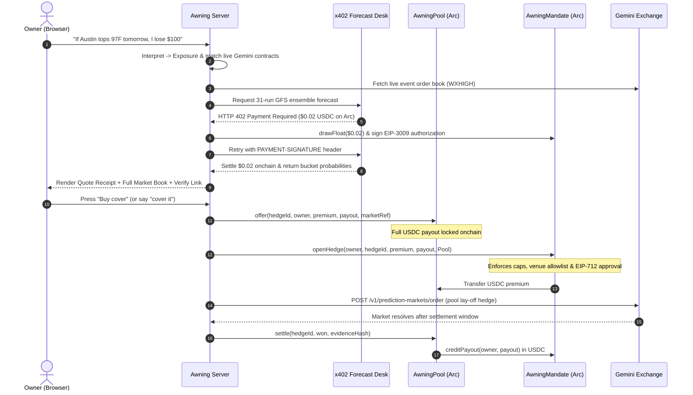

# Awning

**Awning pays you when a bad day hits your business.**

Say the day in a sentence: a cold snap, a heat wave, fuel going up. Awning finds the Gemini
prediction market that pays when it happens and shows what cover costs. An AI agent buys it for you,
at a press or at the words "cover it", or keeps buying it every day on its own judgement. Two
contracts on Arc hold the money: a pool that locks your whole payout before you pay a cent, and a
mandate that limits what the agent can spend.

**Try it: https://awning-eight.vercel.app** (Arc testnet). Pick one of the examples and press **Buy
cover**, or press the microphone and say the day. The first purchase gives you test dollars, sets up
your agent and buys. Cover is sized to the test pool, about $50 a time.

**Checking a sponsor's technology?** https://awning-eight.vercel.app/proof lists each one beside the
latest real transaction, order or event behind it, read from the chain as the page opens.


> "If Chicago's high stays under 46 tomorrow, my coffee cart is out about $300."
>
> **Pays $300 if Chicago's high is 45°F or below. Costs $25.60.**
>
> A quote the app gave on 13 November 2026. The examples on the site are priced from Gemini that minute.

Built for the University Blockchain Conference 2026 hackathon.

| Component | Details |
| --- | --- |
| Live app | [awning-eight.vercel.app](https://awning-eight.vercel.app) · [Live onchain proof](https://awning-eight.vercel.app/proof) |
| Agent's limits | [`AwningMandate` (`0x708a...8413`)](https://testnet.arcscan.app/address/0x708ae0910eFAf32B97D0bA9429C4F2BD44988413) on Arc testnet (`5042002`) |
| Cover pool | [`AwningPool` (`0x0dE9...F6F`)](https://testnet.arcscan.app/address/0x0dE9149998eE6CAA3577007f31A1803Bc49C3F6F) on Arc testnet (`5042002`) |
| Settlement asset | Native Arc USDC (`0x3600000000000000000000000000000000000000`) |
| Automated tests | **188 tests**: 126 Foundry contract tests (fuzz + stateful invariants) and 62 Vitest engine and app tests |
| Stack | Next.js 16, React 19, Solidity 0.8.28 (Foundry), viem, Drizzle + Postgres, Google's Gemini model |

## Contents

- [Quick start](#quick-start)
- [What it looks like](#what-it-looks-like)
- [The problem](#the-problem)
- [What Awning does](#what-awning-does)
- [Verifying a quote against Gemini](#verifying-a-quote-against-gemini)
- [Finding the risk in your sales](#finding-the-risk-in-your-sales)
- [The mandate](#the-mandate)
- [The pool](#the-pool)
- [Architecture](#architecture)
- [The agent's decision loop](#the-agents-decision-loop)
- [Economic design and risk assumptions](#economic-design-and-risk-assumptions)
- [Sponsor technology](#sponsor-technology)
- [Running on Arc testnet](#running-on-arc-testnet)
- [Tests](#tests)
- [What is real and what is not](#what-is-real-and-what-is-not)
- [Repository layout](#repository-layout)
- [License](#license)
- [What comes next](#what-comes-next)

## Quick start

Requires Node 22 or newer and [Foundry](https://getfoundry.sh).

```bash
npm install
cp .env.example .env.local     # set GOOGLE_AI_API_KEY
npm run chain                  # local chain with both contracts and a funded pool
npm run dev                    # in a second terminal
```

Open http://localhost:3000 and type a risk into the box, or go to **Get cover** and pick one of
the examples, which are read from Gemini's prices that minute. The first time you press **Buy cover**
it also sets up your agent: test dollars in a vault, and spending limits you can change under
**My agent**.

`GOOGLE_AI_API_KEY` is the only key you need, and only for typed sentences and the agent's daily
decision; a free one from Google AI Studio is enough. (Two things here are called Gemini and they are
unrelated: the markets are on the Gemini exchange, and the model that reads a sentence is Google's.)
Everything else in `.env.example` is optional: with no Gemini trading keys the pool's own hedge fills
on paper against Gemini's live prices. The cover itself is real either way, locked onchain and paid
on Gemini's resolution.

## What it looks like

**The map.** Every US city Gemini lists a temperature high for, with what a bad day there costs to
cover this minute and how the market's odds of it have moved through the day.



**A quote.** What the cover pays, the market's odds, what it costs, the full Gemini contract book
with a direct verification link to Gemini's JSON endpoint, the 31-run weather ensemble comparison,
and where a payout could differ from your actual loss. The microphone beside the buy button takes
"cover it" for an answer.


**The hijack test.** One button hands the agent's real key to an attacker and sends real
transactions. The contracts refuse everything except the day's data budget. In this run on Arc
testnet that budget was already spent, so the attacker left with nothing.


**The proof page.** For anyone checking that a sponsor's technology is really used: each one, what
Awning does with it, and the latest real transaction behind that.



**Light and dark.** The site follows the device, or the switch in its header.



## The problem

Small businesses carry risks nobody will insure: a cold day, a spike in fuel, the home team losing.
Prediction markets price exactly these events, and owners have started using them by hand (Fortune
reported a restaurant group putting $60,000 on a baseball outcome in October 2026). Doing it by hand
means finding the right contract among a thousand, working out how many to buy, and understanding
where the market's settlement differs from your actual loss. Almost nobody will.

Handing the job to an AI agent creates the second problem. An agent that can spend money and reads
text written by strangers will eventually be talked into something. A spending limit written in a
prompt is a suggestion.

## What Awning does

```mermaid
flowchart LR
    A["1. Describe risk in plain words (type or voice)"] --> B["2. Structured Exposure (Google Gemini model)"]
    B --> C["3. Match & price live Gemini contracts"]
    C --> D["4. Second opinion (31-run GFS forecast via x402)"]
    D --> E["5. AwningPool.offer locks full payout on Arc"]
    E --> F["6. AwningMandate.openHedge pays premium within limits"]
    F --> G["7. Pool lays off risk on Gemini Sandbox"]
    G --> H["8. AwningPool.settle pays USDC on resolution"]
```



1. **You describe a risk in a sentence**, typed or spoken.
2. **Google's Gemini model turns it into a structured exposure**: what has to happen, where, when,
   and what it costs you. If something essential is missing it asks one question. If Gemini lists
   nothing that tracks the risk, it says so and records the gap.
3. **The engine matches it to live Gemini contracts** and builds the position that pays when your
   trigger happens: a basket of temperature buckets, a Yes or No on a price strike, or a No on a team.
4. **You get a receipt and the live market book**: what it pays, the market's odds, what it costs,
   every contract in the Gemini event with its symbol and bid/ask, and a plain account of where a
   payout could differ from your loss (the settlement station, a snapped threshold, a proxy asset, a
   thin book).
5. **For temperature markets the agent checks a second opinion.** It compares Gemini's implied odds
   against a 31-member Open-Meteo GFS ensemble forecast (shown immediately on your first quote, and
   paid at $0.02 over x402 from the agent's data float once your vault is active).
6. **The pool offers the cover and locks the payout.** Asking to buy has the pool post an offer
   onchain, which sets the whole payout aside in `AwningPool` before any premium moves.
7. **The agent asks the mandate for the premium.** Inside your limits it acts immediately. Above your
   approval line it comes back for an EIP-712 signature from your device. Outside your limits the
   contract refuses and emits a permanent `Blocked` event onchain.
8. **The pool covers itself on Gemini** by buying the same position there. That is the pool's
   business: your cover is in force whether or not its order fills.
9. **When Gemini resolves the market**, the pool pays your vault in USDC, or keeps the premium.

You can also leave a daily risk with the agent. Each day it looks at that day's price and forecast
and decides for itself whether the cover is worth buying, inside a cap you set, and writes down why.

None of it needs typing. Press the microphone, say the day, hear the price, say "cover it".

## Verifying a quote against Gemini

Every quote exposes the raw data behind its price so an owner or judge never has to take the UI on
trust:

| On the quote screen | What it proves and how to verify |
| --- | --- |
| **What Gemini is quoting across this market** | Horizontal outcome distribution bar chart across every contract in the Gemini event. Contracts included in your cover are highlighted in amber (`In your cover (Yes)` or `(No)`). |
| **Contract symbols & live order book** | Every row displays the exact Gemini contract symbol (`GEMI-...`), live `Bid` and `Ask`, 24h contract volume, and the weather model's per-bucket share. |
| **Verify live JSON on Gemini** | One-click link to `https://api.gemini.com/v1/prediction-markets/events/{ticker}` so you can compare the raw exchange payload against the quote on screen. |
| **Live WebSocket book ticker** | While a quote is open, the browser subscribes directly to `wss://ws.gemini.com` (`<symbol>@bookTicker` for each leg) and flashes when the exchange price moves. |
| **What $1 of this cover has cost (`Now · Low · High`)** | Charts 48 hours of 5-minute Gemini snapshots recorded by Awning and displays `Now`, `Low`, and `High` per dollar of payout. |
| **Weather model vs. market odds** | Side-by-side comparison of Gemini's implied probability and the 31-run GFS ensemble probability at the exact NWS settlement station. |

## Finding the risk in your sales

Most owners can't say what a cold day costs them. **Find my risk** works it out from their own books.



1. **Upload a spreadsheet export of daily sales**, or try the built-in sample.
2. **Awning looks up the official settlement station** for that city's Gemini market
   (`src/lib/weather/stations.ts`, read from the National Weather Service) and pulls the daily high
   there for every day in the file.
3. **`src/lib/discover/analyze.ts` finds the temperature threshold where takings drop**:
   - Each day is compared with other days **in the same month and on the same weekday**, taking both
     seasonality and day-of-week patterns out of sales and weather before comparing. A business that
     is simply busier in summer, or on Saturdays, shows no false effect.
   - Every whole-degree threshold between the 5th and 95th percentile is tested in both directions.
   - Because testing many thresholds can make the best one look significant by luck, the weather is
     shuffled within each month 800 times, the full threshold search is rerun on every shuffle, and a
     finding is reported only if fewer than 1 in 100 shuffles (`p < 0.01`) do as well.
4. **The output is a dollar loss per bad day** with a range, how many days a year it applies to, and
   a scatter chart of every day in the file. One click prices cover for it without calling the LLM:
   the statistical finding is already the structured `Exposure` the hedge engine consumes.

What it can't do: it treats days as independent, so a slow fortnight that happens to be cold can
look like weather. The highs come from a weather archive for the station's coordinates rather than
the station's own climate report, so they can be a degree or two off. And one no-effect file in a
hundred will still pass at `p < 0.01`, which is why the page shows the permutation odds instead of
hiding them.

## The mandate

`contracts/src/AwningMandate.sol` holds each owner's USDC and enforces what their agent may do
onchain:



| Limit | Enforced onchain in `AwningMandate.sol` |
| --- | --- |
| Daily allowance for buying data | `drawFloat` moves at most `dailyFloatLimit` per UTC day to the agent's address |
| Most for one cover | `openHedge` refuses a premium larger than `maxSingleHedge` |
| Most for cover per 30-day period | `openHedge` refuses once `spentInPeriod + premium > periodLimit` |
| Where premiums may go | `openHedge` only pays addresses the owner has allowlisted (`venueAllowed`) |
| Ask me first above | Premiums above `requireApprovalAbove` require the owner's EIP-712 signature over the exact terms |
| Pause | `setPaused(true)` halts all agent actions immediately |
| Expiry | The mandate lapses automatically at the `expiresAt` timestamp set by the owner |

A refusal is not a silent revert. When `openHedge` or `drawFloat` violates a policy limit, the
transaction succeeds, moves zero USDC, and emits
`Blocked(owner, agent, action, reason, amount, counterparty, ref)`, making every denied attempt part
of the permanent onchain audit trail and the owner's activity feed.

### What a hijacked agent can take

The app includes a **Hijack my agent** button that hands the agent's real private key to an attacker
script and sends five real transactions against Arc testnet:

| Attack step | Attempted call | Onchain outcome |
| --- | --- | --- |
| 1. Drain to attacker wallet | `openHedge` paying attacker address | **Blocked** (`VenueNotAllowed`) |
| 2. Unbacked payment to pool | `openHedge` paying $1 to `AwningPool` with no matching offer | Mandate allows $1 to approved pool; `AwningPool.reject` immediately returns the $1 to the owner's vault |
| 3. Oversized single hedge | `openHedge` for entire vault balance | **Blocked** (`SingleHedgeCap`) |
| 4. Drain via data float | `drawFloat` for entire vault balance | **Blocked** (`DailyFloatCap`) |
| 5. Sweep remaining daily float | `drawFloat` for `floatRemainingToday` | **Succeeds** (bounded to at most $2.00/day by default) |

With the default limits the attacker gets at most $2.00 out of a $2,000 vault (and $0.00 if the day's
data budget was already used). The contract exposes that exact ceiling as
`limits(owner).floatRemainingToday`, and the app displays it before the button is pressed.

The owner's private key never reaches the server. It is generated in the browser and kept in local
storage; `AwningMandate` verifies owner signatures through OpenZeppelin's `SignatureChecker`, so
ERC-1271 passkey smart accounts work without modifying the contract.

## The pool

`contracts/src/AwningPool.sol` is the counterparty to every cover. It is an ERC-4626 USDC vault whose
depositors earn premiums and bear payouts.



| Step | What happens onchain in `AwningPool.sol` |
| --- | --- |
| **Offer** | Underwriter posts `offer(hedgeId, owner, premium, payout, marketRef, takeBy, resolveBy)`. Pool requires free liquidity `>= payout`, locks `payout`, and enforces the 50% single-market concentration cap. |
| **Take** | Owner's agent pays `premium` through `AwningMandate` with `AwningPool` as venue. `taken(hedgeId)` reads the mandate directly and verifies the same owner paid the exact offered terms before `takeBy`. |
| **Settle** | Resolver reports `settle(hedgeId, won, evidence)`. Pool either pays the full locked `payout` into the owner's mandate vault (`creditPayout`) or unlocks the reserve and books `premium` to pool assets. |
| **Lapse** | Any offer not taken by `takeBy` (5 minutes) can be unlocked by anyone via `lapse(hedgeId)`. |
| **Reject** | Any payment that reached the pool without matching a live offer (wrong terms, expired offer, or unoffered ID) is refunded to the owner's vault by anyone via `reject(hedgeId)`. |
| **Claim** | If the resolver does not report by `resolveBy` (3 days after market close), anyone can call `claim(hedgeId)` to pay the owner the full payout automatically. |

Depositors can withdraw only unlocked liquidity. The pool maintains strict internal accounting
(`accountedAssets`): a premium counts toward the pool's withdrawable assets only after its cover has
settled, so stray transfers or active premiums cannot be withdrawn or double-committed. The Foundry
invariant suite proves across randomized action sequences that the pool's USDC balance always covers
`accountedAssets`, `accountedAssets` always covers `locked`, and `locked` always equals the sum of
live offers.

## Architecture



### Core modules

| Module | Responsibility |
| --- | --- |
| `src/lib/gemini` | Reads Gemini's prediction market REST API, validates Fahrenheit temperature range partitions, handles post-midnight Eastern same-day market rollover, normalizes partitions, price ladders, and moneylines, and executes HMAC-SHA384 signed orders against Gemini Sandbox. |
| `src/lib/hedge` | Pure, unit-tested hedging engine: `Exposure` schema, exact-first contract matching, basket construction, taker/maker fee pricing, live market outcome distribution rows (`MarketRow[]`), and basis-risk scoring. |
| `src/lib/covers` | Coordinates `AwningPool.offer`, `AwningMandate.openHedge`, Gemini lay-off orders, automatic resolution polling against Gemini, and the 5-step live hijack test. |
| `src/lib/agent` | Runs standing orders once per minute, compares market price against the 31-run ensemble forecast, asks the model for a structured buy-or-skip decision, and records the full rationale. |
| `src/lib/desk` | Official `@x402/core` + `@x402/evm` v2 forecast seller (`/api/desk/forecast`) and agent buyer with a hard $0.05 per-request ceiling and payee allowlist. |
| `src/lib/discover` | Parses uploaded daily sales CSVs, joins NWS settlement station coordinates with Open-Meteo archive temperatures, de-trends by month and weekday, and runs an 800-shuffle Monte Carlo permutation test. |
| `src/lib/ledger` | Stores `AwningMandate` and `AwningPool` events delivered by QuickNode Streams (`/api/streams`) with automatic RPC log backfill when the stream is idle. |
| `src/lib/chain` | Typed `viem` bindings for Arc Testnet, browser device wallet management, and Circle CCTP V2 cross-chain cash-out (`src/lib/chain/cctp.ts`). |

## The agent's decision loop



### Interactive purchase vs. autonomous standing order

- **When you ask for cover directly**, the model is called once to turn your sentence into an
  `Exposure` (or ask one clarifying question). Every step after that—market matching, leg snapping,
  x402 forecast verification, pricing, `AwningPool.offer`, `AwningMandate.openHedge`, and the Gemini
  lay-off order—is deterministic code.
- **When you leave a daily standing order**, the background loop wakes once a minute for today's and
  tomorrow's market:
  1. **Look** (code + paid data): price the day's cover from Gemini and fetch that day's 31-run GFS
     forecast.
  2. **Rule out** (code): skip without calling the model if cover costs what it pays, exceeds the
     owner's daily cap, or crosses the owner's ask-first signature threshold.
  3. **Decide** (Google's Gemini model, structured output): given the cost, the market's implied odds,
     the weather model's odds, the cap, and the owner's instructions, decide `buy` or `skip` and state
     the reason in plain words.
  4. **Act & record** (code): on `buy`, execute `AwningPool.offer` and `AwningMandate.openHedge` and
     store the decision, numbers, and transaction hashes on the **My agent** page. At most one
     decision is executed per standing order per market day.

### Safety limits in force

- **Onchain, outside the model**: every limit in `AwningMandate` (`dailyFloatLimit`,
  `maxSingleHedge`, `periodLimit`, `requireApprovalAbove`, `venueAllowed`, `paused`, `expiresAt`).
- **In the x402 client**: a hard per-request ceiling of `$0.05` and an allowlist of seller addresses,
  checked before any EIP-3009 authorization is signed.
- **In the server**: quotes are always re-priced server-side from live Gemini data at purchase time;
  browser numbers are never trusted. Each cover's onchain `marketRef` commits to the exact Gemini
  contract symbols and sides it was priced on.
- **At the API boundary**: every request that reads or spends an owner's account carries a session
  token signed by that owner's key and verified against the chain.
- **In the pool**: cover exists only on terms the underwriter offered before `takeBy`. Any other
  transfer is refundable via `AwningPool.reject`.

## Economic design and risk assumptions

- **Cover is a binary position, not an insurance policy.** Awning buys binary contracts that pay $1
  each. The cost of cover is the market's probability plus fees. Likely events are expensive to cover
  and the receipt says so.
- **Basis risk is stated up front, never hidden.** Temperature markets settle on one airport station
  per the NWS daily climate report. Price markets settle on a reference index at one moment. A proxy
  (such as diesel hedged with WTI or Brent crude) is flagged and scored down.
- **The pool is the direct counterparty.** Owners buy from `AwningPool` at Gemini's asking price plus
  Gemini's fee, so the pool can lay the risk off immediately. When a contract has no active offer on
  Gemini, the pool prices off the middle of the book anchored by `min(mid, fair)` and carries the
  position until its resting order fills.
- **Liquidity and concentration guards.** The pool refuses any cover it cannot 100% collateralize up
  front, and caps exposure to any single market at 50% of total pool assets.
- **Quotes expire in five minutes.** After `takeBy`, an untaken offer lapses and its locked payout is
  released, so a quote cannot be held as a free option while the market moves.
- **The forecast is a second opinion, not ground truth.** It is a 31-member GFS ensemble with half a
  member of Laplace smoothing per bucket. It can lower a bid when the book has no ask, and never
  raises one.
- **Trust boundaries.** Gemini is a centrally cleared exchange with offchain resolution:
  - The *resolver* key reports Gemini's public resolution (`settle(hedgeId, won, evidence)`). If the
    resolver goes silent for three days past market close (`resolveBy`), the owner claims the full
    payout permissionlessly via `claim(hedgeId)`.
  - The *underwriter* key posts pool offers.
  - In this hackathon build one server holds the agent, underwriter, and resolver keys. Compromising
    the agent key alone yields at most the daily data float ($2.00 default), proven live by the
    hijack test. Separating the underwriter and resolver onto independent hosts with an onchain
    dispute window is the first production milestone.
- **Fees** use Gemini's quadratic schedule `rate × price × (1 − price)` per contract (7% taker,
  1.75% maker).

## Sponsor technology

### 1. Arc (`5042002`)

Both core contracts are deployed and verified in production on Arc testnet. Native USDC is the vault
asset, the underwriting pool asset, the x402 payment asset, and the gas token, so an owner manages a
single dollar balance.

| Contract | Arc Testnet Address |
| --- | --- |
| `AwningMandate` | [`0x708ae0910eFAf32B97D0bA9429C4F2BD44988413`](https://testnet.arcscan.app/address/0x708ae0910eFAf32B97D0bA9429C4F2BD44988413) |
| `AwningPool` | [`0x0dE9149998eE6CAA3577007f31A1803Bc49C3F6F`](https://testnet.arcscan.app/address/0x0dE9149998eE6CAA3577007f31A1803Bc49C3F6F) |
| Native USDC | `0x3600000000000000000000000000000000000000` (EIP-3009 domain `USDC` / version `2`) |

### 2. Gemini Prediction Markets

- **Live market data & WebSocket streaming**: `GET /v1/prediction-markets/events` (filtered by
  category, search, and status), `GET /v1/prediction-markets/events/{ticker}` for live contract books
  and resolutions, and `wss://ws.gemini.com` (`<symbol>@bookTicker`) for real-time quote updates.
- **24/7 market continuity & partition validation**: `src/lib/hedge/examples.ts` and
  `src/lib/gemini/market.ts` validate full Fahrenheit range partitions across 49 US cities and
  automatically bridge post-midnight Eastern Time windows using active same-day contracts until
  tomorrow's weather markets list.
- **HMAC-SHA384 sandbox hedge execution**: `POST /v1/prediction-markets/order`, `/orders/active`,
  `/orders/history`, and `/terms/status`. When a cover is bought on contracts listed in Gemini's
  sandbox (commodities and crypto, sharing production tickers), the pool places a real authenticated
  lay-off order on Gemini Sandbox and stores the order ID on the cover receipt and `/proof` (including
  Brent order `145853902319270757` on `GEMI-BRENT2611152200-HI92` and WTI order ending `731276` on
  `GEMI-WTI2611202200-HI84`). For weather and sports contracts not listed in the sandbox, the pool
  records a paper fill at Gemini's live ask.
- **48-hour snapshot recorder**: Awning polls every city's temperature market and commodity ladder
  every five minutes so the map and quote screen can chart 48-hour probability and cost history
  (`Now · Low · High`).

### 3. x402

The forecast desk (`/api/desk/forecast`) and the agent's buyer (`src/lib/desk/client.ts`) use the
official `@x402/core` and `@x402/evm` packages (v2 protocol, `exact` scheme). Each paid forecast
request returns HTTP `402 Payment Required`, the agent draws from its mandate data float if needed,
signs an EIP-3009 `transferWithAuthorization` on Arc native USDC for `$0.02`, and the desk settles
the transfer onchain before returning the 31-run ensemble probabilities.

### 4. Circle CCTP V2

"Send money out" on the **My agent** page withdraws USDC from the owner's `AwningMandate` vault and
burns it through Circle CCTP V2's `TokenMessengerV2` on Arc (domain `26`) with the Forwarding Service
hook (`depositForBurnWithHook`), minting native USDC on Base Sepolia, Ethereum Sepolia, or Avalanche
Fuji with zero destination gas required from the user. Fees are fetched live from Circle's
`/v2/burn/USDC/fees` and attestation delivery is tracked through `/v2/messages`.

### 5. QuickNode Streams

The activity ledger is fed by the `awning-ledger` QuickNode Stream watching Arc testnet:

- **Dataset**: `block_with_receipts` so every event arrives with its block timestamp in a single hop.
- **Filter (`quicknode/filter.js`)**: retains logs emitted by `AwningMandate` or `AwningPool`,
  attaches the block timestamp, and returns `null` on empty blocks so no credits are wasted.
- **Webhook (`POST /api/streams`)**: verifies `X-QN-Signature` (`HMAC-SHA256` over
  `nonce + timestamp + body`), inflates gzip payloads, and upserts events idempotently by
  `txHash:logIndex`. When the stream has been quiet for 90 seconds, the app backfills from RPC logs
  into the same table so nothing is missed or double-counted.

### 6. ElevenLabs

Scribe (`scribe_v2`) transcribes spoken risks from the browser microphone; Flash
(`eleven_flash_v2_5`) speaks clarifying questions, the quote summary, confirmation prompts, and
mandate refusals. Saying the risk, hearing `"Say cover it to buy"`, and replying `"cover it"`
completes the entire purchase flow hands-free. Affirmative phrase matching is strictly tested in
`src/components/voice.test.ts` so a new risk sentence beginning with the word `"cover"` is never
mistaken for a purchase confirmation.

## Running on Arc testnet

Put three fresh keys in `.env.arc` (the chain block of `.env.example`, with
`AWNING_DATA_DIR=.data/pg-arc` so Arc covers stay separate from local ones), fund the venue address
with testnet USDC from https://faucet.circle.com, then run:

```bash
scripts/deploy-arc.sh   # deploys both contracts, seeds the pool, funds gas, and writes .env.arc
npm run start:arc       # production build against Arc on http://localhost:3001
```

Arc enforces a 20 gwei minimum base fee; `scripts/deploy-arc.sh` sets explicit gas parameters so
Foundry broadcasts cleanly.

### Hosting

The app runs on any Node host. On a long-running server it runs its background work (settling
resolved covers, recording 5-minute Gemini snapshots, and evaluating standing orders) on a one-minute
timer. On serverless hosts such as Vercel, `/api/wake` runs the same pass on demand, triggered every
ten minutes by `.github/workflows/wake.yml` and daily by `vercel.json`.

## Tests

```bash
npm test                       # 62 Vitest tests: engine, rollover, settlement, forecast, CSV discovery, voice
npm run typecheck && npm run lint
cd contracts && forge test     # 126 Foundry tests: unit, fuzz, and stateful invariants on both contracts
FOUNDRY_PROFILE=ci forge test  # deep fuzz and invariant profile (4x runs)
LIVE=1 npx vitest run src/lib/hedge/live.test.ts   # end-to-end sentence -> priced cover against live APIs
```

## What is real and what is not

| Real in this build | Stand-in or current limitation |
| --- | --- |
| Live Gemini markets, order books, WebSocket ticks, and resolutions | Gemini Sandbox lists commodities and crypto (real sandbox order IDs) but not weather or sports (recorded as paper fills against live Gemini prices) |
| Full onchain payout collateralization and settlement in `AwningPool` | The resolver reporting Gemini's resolution is a single operator key (backed by a 3-day automatic payout timeout to the owner) |
| Every `AwningMandate` policy check, `Blocked` event, and the live hijack test | Owner key is stored in browser `localStorage` rather than a hardware passkey (contracts already use `SignatureChecker` for ERC-1271) |
| Autonomous standing-order decisions by Google's Gemini model | Agent, underwriter, and resolver keys currently run on one server |
| Onchain x402 EIP-3009 USDC settlement per forecast request | The x402 forecast desk is operated by the same deployment as the agent |
| 31-run Open-Meteo GFS ensemble forecasts and 48-hour Gemini odds history | The GFS ensemble is not yet station-bias corrected |
| CSV sales risk discovery against real historical station weather | The one-click sample CSV uses synthetic daily sales layered over real historical weather (and labels itself as a sample) |
| Circle CCTP V2 cross-chain USDC burn and forwarding from Arc | Testnet pool liquidity is seeded by the operator |
| QuickNode Streams delivery with `HMAC-SHA256` signature verification | Stream can be paused between demos to conserve credits; the app seamlessly falls back to direct RPC log reads |
| ElevenLabs `scribe_v2` STT and `eleven_flash_v2_5` TTS voice buying | End-to-end tested on Arc testnet with recorded audio and browser microphone input |

## Repository layout

```text
contracts/        AwningMandate.sol, AwningPool.sol, Foundry tests, deploy scripts
src/app/          Next.js 16 App Router pages and API endpoints
src/components/   UI components (Receipt, Fit market book, CostChart, Map, Voice)
src/lib/hedge/    Core engine: Exposure schema, matching, pricing, basis notes
src/lib/covers/   Quoting, onchain offer/take lifecycle, settlement, hijack test
src/lib/agent/    Autonomous standing orders and daily buy-or-skip decisions
src/lib/chain/    viem contract bindings, browser device wallet, Circle CCTP V2
src/lib/gemini/   Gemini Prediction Markets REST client, normalizer, HMAC trader
src/lib/desk/     x402 v2 forecast seller and bounded agent buyer
src/lib/ledger/   Onchain activity ledger (QuickNode Streams + RPC backfill)
src/lib/discover/ Sales CSV parser, historical weather join, Monte Carlo scanner
src/lib/weather/  Official NWS settlement stations for all 49 US weather cities
quicknode/        QuickNode Stream block_with_receipts filter script
scripts/          Local Anvil chain, Arc deployment, Stream management & replay
drizzle/          Postgres schema migrations
```

The interface is set in [Geist](https://vercel.com/font) Sans. The animated scenes on the landing
page come from [ascii-magic-art](https://www.ascii-magic.com/ascii) (MIT), bundled locally. Every
other illustration (`src/components/Sketch.tsx`) is hand-drawn SVG in ink and amber.

## License

MIT. See [LICENSE](LICENSE).

## What comes next

- An onchain challenge window on settlement reports so any misreported outcome can be disputed before
  funds move.
- Separating the underwriter, resolver, and agent keys across independent hosts.
- Opening permissionless LP deposits into `AwningPool` from the UI with a configurable underwriting
  spread.
- Passkey smart accounts (ERC-1271 / ERC-4337) with sponsored gas for one-tap mobile onboarding.
- Station-bias correction for the 31-run GFS ensemble and options-implied fair values for commodity
  ladders.
- Publishing the recorded unhedged-risk gaps log to Gemini as demand signal for new markets.
